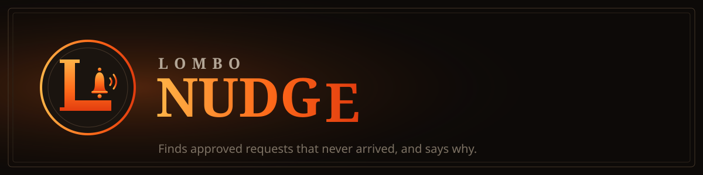

<p align="center"></p>

<p align="center">
  <a href="LICENSE"></a>
  <a href="https://github.com/Lombo-Forge/lombo-nudge/actions/workflows/ci.yml"></a>
  <a href="https://github.com/Lombo-Forge/lombo-nudge/actions/workflows/codeql.yml"></a>
  <a href="https://github.com/Lombo-Forge/lombo-nudge/releases"></a>
  
</p>

# LomboNudge

Finds Seerr requests that were approved but never showed up in your library, tells you why (nothing found, download failed or stalled, import blocked, not in Jellyfin, and more), and sends a webhook alert.

```text
$ lombo-nudge plan
#41 Example Movie (for Sam, 3 d) [not_found] Approved a while ago, nothing queued and no files: the indexers found nothing.
#57 Example Show (for Alex, 5 d) [download_failed] A queued download failed or is flagged with a warning or error.
```

## Contents

- [Install in a minute](#install-in-a-minute)
- [Commands](#commands)
- [Settings](#settings)
- [What is not verified](#what-is-not-verified)
- [FAQ](#faq)
- [Contributing and licence](#contributing-and-licence)

## Install in a minute

1. Find the API keys: Seerr, Sonarr and Radarr under Settings > General (Jellyfin is optional: Dashboard > API Keys).
2. Copy `.env.example` to `.env` and fill in the URLs and keys (at least Seerr and one of Sonarr or Radarr).
3. Start it:
   ```sh
   mkdir data && chown 999 data
   docker compose -f compose.example.yaml up -d
   docker compose -f compose.example.yaml exec lombo-nudge lombo-nudge doctor
   ```

It starts in dry-run mode and sends nothing. Run `lombo-nudge plan` to see what it finds, then set `LOMBO_NUDGE_DRY_RUN=false` to get alerts.

## Commands

| Command | What it does |
|---|---|
| `lombo-nudge doctor` | Checks your settings and that every service answers with its key. Exit code 1 if anything fails. |
| `lombo-nudge plan [--all]` | Lists stuck requests and the reason for each (`--all` shows the fine ones too). Never changes anything. Alias: `check`. |
| `lombo-nudge run [--loop]` | The same, then sends alerts (only when `DRY_RUN=false`). `--loop` repeats every `LOMBO_NUDGE_INTERVAL_SECONDS`. |
| `lombo-nudge retry ID` | Shows what a retry of one request would do: remove and blocklist failed downloads and search again, or just search. Applies it only when `DRY_RUN=false`. |

Every reason code is explained in [docs/how-it-works.md](docs/how-it-works.md).

## Settings

Everything is an environment variable, listed with defaults in [.env.example](.env.example). Thresholds (hours before "nothing found", "partly here", "stalled"), the re-alert wait and the retry cooldown are settings too. More in [docs/setup.md](docs/setup.md).

## What is not verified

Be aware before you rely on it:

- **It has never been run against a real Seerr, Sonarr, Radarr or Jellyfin.** The tests use fake servers that return the shapes the code expects. The API shapes were taken from the code this was ported from (which ran against real servers for its own setup) and from the public API documentation. Newer or older versions may differ.
- **The Jellyfin lookup is the least certain part.** It asks `/Items` with `AnyProviderIdEquals=tmdb.<id>` (or `tvdb.<id>`); that filter format was not confirmed against a live server. If it misbehaves, remove the Jellyfin settings: the reason then falls back to `seerr_not_updated`.
- **"Quality blocked" is a guess from message text** ("quality" or "not an upgrade" in the queue message). A release rejected earlier by the quality profile appears as `not_found`.
- **4K requests are skipped** (`not_checked`); a separate 4K Sonarr/Radarr instance is not supported yet.
- **Stalls need two rounds** to be noticed, and the state file must survive restarts (mount `/data`).
- **`retry` removes and blocklists downloads.** The delete and search calls were ported as they were, but have not been run against a real instance here. Read the dry-run plan first.
- Webhook delivery was tested only against a fake receiver, not Discord or Slack.

## FAQ

**Is it safe to try?** Yes. Dry run is the default: no alerts, no retries, and `plan` never changes anything.

**Will an outage cause a flood of alerts?** No. If Seerr, Sonarr or Radarr cannot be read, the round is skipped.

**Does it touch my library?** No. It only reads. The one exception is `retry`, which asks Sonarr or Radarr to remove a failed download or search again, and only with `DRY_RUN=false`.

**Can I get ntfy, Gotify or email?** Point the webhook at a bridge such as Apprise. The message is sent as JSON with the text under `content` and `text`.

**Why no web page?** It is a small program that watches and speaks up. The list is `lombo-nudge plan`.

## Contributing and licence

Contribution, security and conduct rules come from the [Lombo-Forge organisation](https://github.com/Lombo-Forge/.github). Licensed under [GPL-3.0](LICENSE). Credits are in [NOTICE.md](NOTICE.md). Not affiliated with or endorsed by the Jellyfin, Seerr, Sonarr or Radarr projects.
